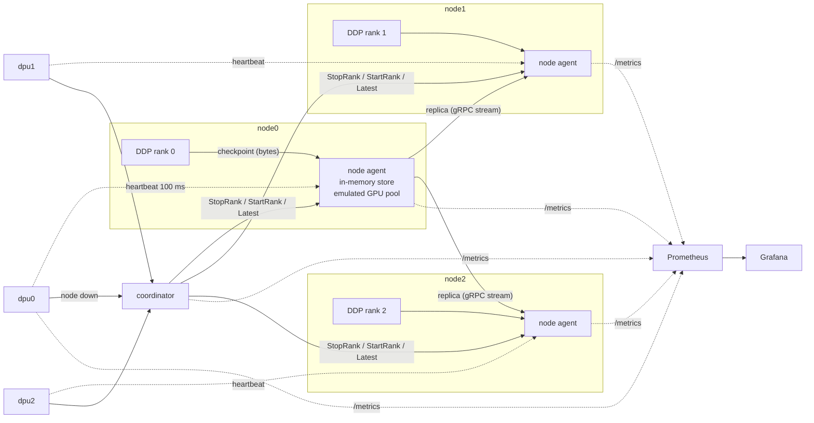

# Architecture

Only three of the eight nodes are drawn. Every node has the same shape.

## Components

| Component | Code | Role |
|---|---|---|
| Node agent | `failover_lab/agent.py` | One per compute node. Holds the checkpoint store inside an emulated GPU memory budget, pushes each new checkpoint to two ring neighbours, launches and stops the local training rank. |
| Checkpoint store | `failover_lab/store.py` | Keeps the newest two versions per job. Verifies size and SHA-256 before admitting a checkpoint and never evicts the last valid one. |
| Trainer | `failover_lab/trainer.py` | One PyTorch DDP rank (gloo backend, CPU). Rank 0 serialises model and optimizer state on a timer. |
| Mock DPU | `failover_lab/dpu.py` | One per node, in its own process or container. Heartbeats its host and reports loss to the coordinator. |
| Coordinator | `failover_lab/coordinator.py` | Launches the job, receives failure reports, fences and stops the old incarnation, finds the newest surviving checkpoint and relaunches on the survivors. |

## Normal operation

1. The coordinator asks every agent for its newest checkpoint (none on a fresh job) and starts one rank per node.
2. Ranks train. Each reports its step to its local agent ten times a second.
3. Every checkpoint interval, rank 0 serialises its state and streams it to the agent on its own node. This is the only part that blocks training.
4. The agent verifies and stores the checkpoint, acknowledges, and then replicates it to two peers in the background.

## Failover

1. A node dies. Its rank, its agent and every checkpoint in its memory are gone.
2. Its DPU misses three heartbeats and reports the node down.
3. The coordinator waits 200 ms so reports about simultaneous failures arrive together, stops the surviving ranks and sends a best-effort stop to the nodes it declared dead (fencing).
4. It asks the survivors for their newest checkpoint and picks the highest version.
5. It starts a new incarnation on the survivors. Every rank pulls that checkpoint from the peer that holds it, verifies the hash, loads it and rejoins.
6. Training continues from the checkpointed step with a smaller world size.

With two replicas there are three copies of each checkpoint, so any two simultaneous node failures leave at least one copy. Three failures that hit the origin and both of its replica holders lose the newest checkpoint; the job then falls back to an older version held elsewhere, or to step 0.

## Baseline path

The same code runs the baseline with `--mode legacy --detect poll`: rank 0 writes the checkpoint to a shared directory with `fsync` and an atomic rename, the DPU reports are ignored, and a node is declared dead only after it has been silent for the scheduler-style timeout. Recovery is a full restart from the file.
